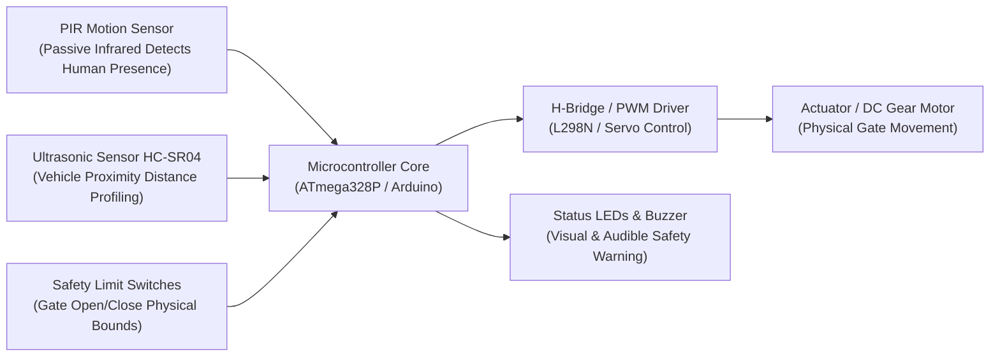

# 🚪 Automatic Sensor-Controlled Gate & Smart Access Barrier System

[](#)
[](https://arduino.cc)
[](#)
[](LICENSE)

An automated electronic access control and smart barrier gate system integrating motion sensing, ultrasonic distance profiling, micro-servomotor actuation, and safety interlocks. Authored by **Ammar Abdelfattah** for the **Applied Physics & Electronics Lab** at **Faculty of Engineering – New Ismailia National University (NINU)**.

---

## 📌 Circuit Architecture & Component Breakdown



### Bill of Materials (BOM) & Electronic Specifications:
1. **Sensing Unit**:
   - **HC-SR04 Ultrasonic Transducer**: Emits $40\text{ kHz}$ ultrasonic sound bursts; measures echo travel time ($t$) to calculate object distance:
     $$\text{Distance (cm)} = \frac{t \times 0.0343}{2}$$
   - **PIR Pyroelectric Sensor**: Detects radiant infrared flux differentials caused by human or vehicle intrusion within a 120° conic envelope.
2. **Control Logic & Actuation**:
   - Microcontroller calculating distance thresholds with software debounce and hysteresis filters.
   - High-torque SG90 / MG996R servo motor providing angular positioning from 0° (fully closed) to 90° (fully open).
3. **Safety & Failsafe Protocols**:
   - Obstacle detection auto-reverse: If an obstruction is detected while the barrier is descending, the gate immediately halts and reverses to 90°.
   - Timeout auto-close timer with audible buzzer indicators before actuation.

---

## 📁 Repository Structure

```text
├── firmware/
│   └── gate_controller.ino     # Production C/C++ firmware with state machine
├── schematics/
│   └── circuit_schematic.png   # Full breadboard and wiring diagram
├── docs/
│   └── physics_sensor_calc.pdf # Calibration and sensor propagation analysis
└── README.md
```

---

## 👨‍💻 Author

- **Ammar Abdelfattah**
- Faculty of Engineering, **New Ismailia National University (NINU)**
